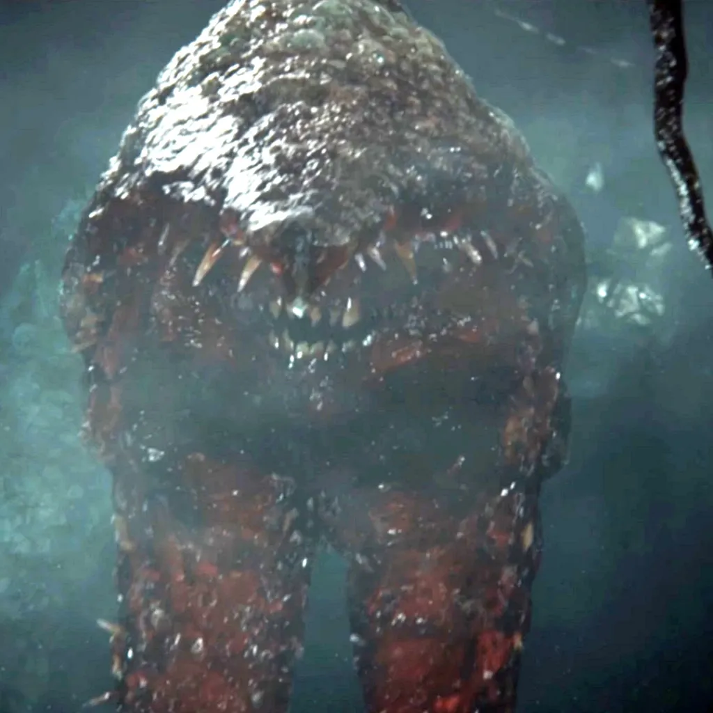

<p align="center">
	<a href="https://github.com/drewdrew21b/project-gravemind-mac-port/blob/main/launcher/Resources/ProjectGravemindIcon.png">
		
	</a>
</p>

<h1 align="center">Project Gravemind Mac Port</h1>

<p align="center">
	<a href="#install"></a>
	<a href="LICENSE"></a>
	<a href="https://github.com/drewdrew21b/project-gravemind-mac-port/releases/latest"></a>
	<a href="https://github.com/drewdrew21b/project-gravemind-mac-port/actions/workflows/checks.yml"></a>
	<a href="#requirements"></a>
</p>

An experimental Apple Silicon launcher for [Project Gravemind](https://github.com/BriRoz1/h2gravemind-releases), the Halo 2 project for Halo: The Master Chief Collection. It installs the Windows release under Wine and downloads the required MCC files from the player's own Steam account.

Project Gravemind is distributed as a Windows-only executable, and its source is not public. This Mac port has not yet been verified in an actual Gravemind multiplayer or campaign session. Graphics, audio, controllers, networking, Steam integration, and updates may need further work on Wine.

## Credits

This Mac port builds on [Project Reclaimer Mac Port](https://github.com/mattromano/project-reclaimer-mac-port) by Matt Romano. It downloads Project Gravemind releases from [BriRoz1/h2gravemind-releases](https://github.com/BriRoz1/h2gravemind-releases). Halo: The Master Chief Collection and Halo 2 are Microsoft properties; this project is independent and is not affiliated with Microsoft, Valve, or the Project Gravemind developers.

## Requirements

- Apple Silicon Mac (M1 or newer) and macOS 14 or newer
- A Steam copy of Halo: The Master Chief Collection with Halo 2 available to the account
- About 82 GB free disk space for Halo 2 campaign, multiplayer, and MCC shared files
- Apple's command-line developer tools and Rosetta 2 (the installer helps with both)

The port does not include MCC or Halo game files. Halo 2 campaign is depot `976735`; its multiplayer maps are in depots `976736` and `976737`; MCC shared files are in depot `976731`.

## Install

This repository does not currently publish a DMG. To install Project Gravemind, open Terminal and run:

```bash
/bin/bash -c "$(curl -fsSL https://raw.githubusercontent.com/drewdrew21b/project-gravemind-mac-port/main/install.sh)"
```

1. The installer checks for an Apple Silicon Mac, macOS 14 or newer, Apple's developer tools, and enough free disk space. It installs Rosetta if needed and asks for your Mac password when macOS requires it.
2. It sets up the Windows compatibility and graphics layers, then downloads the latest verified Project Gravemind release. It also:
	- asks you to scan a Steam QR code with the Steam app on your phone;
	- downloads Halo 2 campaign, multiplayer, and MCC shared files from your own Steam account (about 78 GB);
	- creates **Project Gravemind** in `~/Applications`.
3. Open Project Gravemind from Applications, Launchpad, or Spotlight. It checks for Mac-port and game updates when opened.

If installation stops, run the same command again; completed steps are reused and Steam downloads can resume. Existing `~/Games/ProjectReclaimer` and **Project Reclaimer** app data are not reused or removed.

To build the launcher app and a local disk image from source, run `scripts/make_launcher.sh` and `scripts/make_dmg.sh`.

## Updates and settings

Opening the Mac launcher checks for a newer Mac-port version and the latest Project Gravemind release. The game package is downloaded from GitHub Releases and checked against the release's published SHA-256 digest before installation.

Project Gravemind stores its settings, campaign saves, and mods in its own `Documents\My Games\Project Gravemind` folder inside the Wine prefix. The game can be started from the launcher or directly with `scripts/run.sh`.

## Compatibility notes

- The upstream README says Gravemind finds MCC in Steam libraries and supports selecting a different MCC folder in **Settings > Language and folders > MCC folder**. This port stages MCC under the Wine prefix's Windows Steam path, but that discovery path still needs end-to-end confirmation on macOS.
- If Gravemind asks you to select MCC, choose `C:\Program Files (x86)\Steam\steamapps\common\Halo The Master Chief Collection` in its Wine file picker.
- Gravemind's Workshop instructions say Steam must be open when it downloads a mod. This port does not yet run the Steam client under Wine or provide a Mac-side Gravemind Workshop downloader, so Workshop mods may not download.
- The launcher uses the existing Wine and DXVK setup from the Reclaimer port as a starting point. No claim is made that it provides stable performance or full feature parity for Gravemind.
- Halo and Halo: The Master Chief Collection are Microsoft trademarks. This is an independent, non-commercial community project and is not affiliated with Microsoft, Xbox Game Studios, Halo Studios, Bungie, Valve, or the Project Gravemind author.

## How it works

- The SwiftUI launcher checks for Mac-port updates and prepares the Wine environment before starting the game.
- Wine Staging runs the Windows `h2gravemind.exe` under Rosetta. DXVK translates Direct3D 11 to Vulkan, and MoltenVK translates Vulkan to Apple's Metal graphics API.
- The installer uses Steam QR sign-in to download MCC shared files, Halo 2 campaign files, and both Halo 2 multiplayer depots from the player's own Steam account. The game files are not bundled with this port.
- The updater downloads the latest Project Gravemind release ZIP and verifies its published SHA-256 digest before installing it.

## Debug a crash

The launcher normally captures Wine output in `~/Games/ProjectGravemind/logs/client-wine.log` and replaces that file at each launch. To reproduce a crash with detailed Wine exceptions/network traces and DXVK info logs without overwriting it, quit the game and start it once from Terminal:

```bash
GRAVEMIND_DEBUG=1 "$HOME/Games/ProjectGravemind/game/launch.sh"
```

This writes `client-wine-debug.log` and DXVK logs in the same `logs` folder. Debug output can grow quickly; turn it off after one reproduction. **Tools > Make Report** includes both logs.

## Uninstall

Use **Tools > Uninstall** in the app, or run:

```bash
/bin/bash -c "$(curl -fsSL https://raw.githubusercontent.com/drewdrew21b/project-gravemind-mac-port/main/uninstall.sh)"
```

The Gravemind uninstaller removes the app in `~/Applications` and its `~/Games/ProjectGravemind` folder, including Halo 2 files, Wine, and settings. It does not remove a separate legacy Project Reclaimer install.
